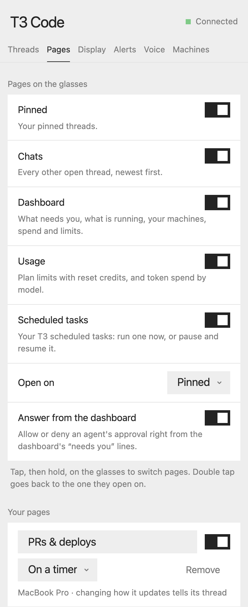
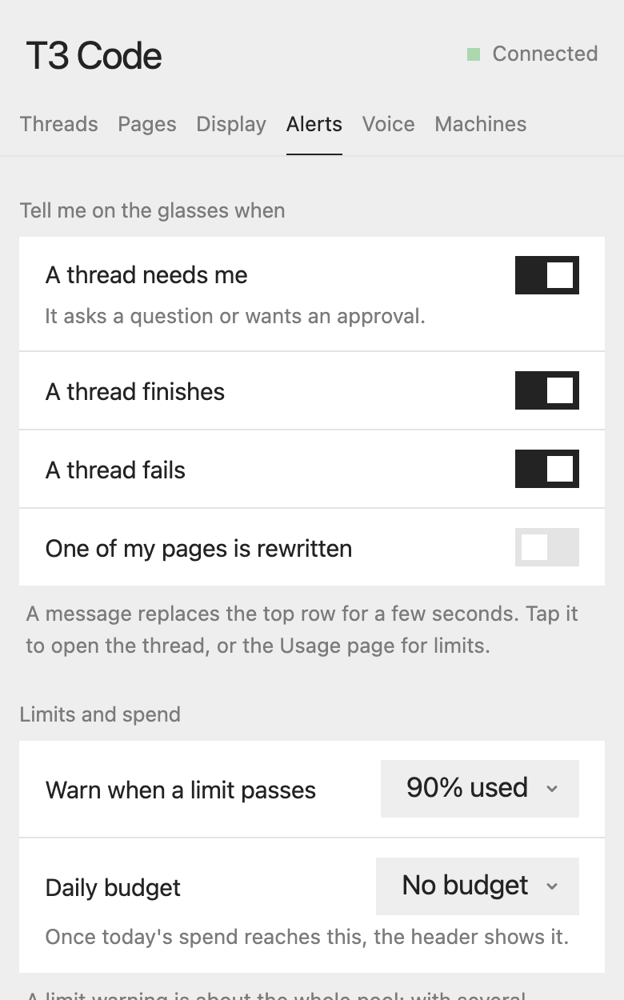
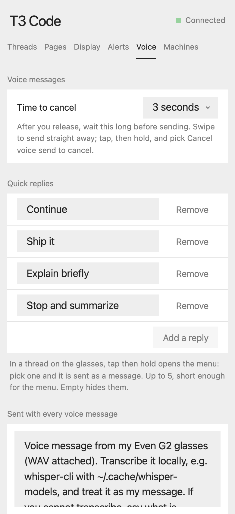

# T3 Code G2

Your pinned [T3 Code](https://github.com/pingdotgg/t3code) threads on Even Realities G2 glasses: what each agent is doing right now, its replies as they stream in, and push-to-talk voice messages that steer it. Start new threads by voice too.

It runs as an Even Hub app on your phone and talks straight to your own T3 server, paired the same way as T3's mobile app. No bridge, no cloud service, no transcription service: the agent transcribes your audio on your machine.

| Pinned threads | A thread, live | Answering a question |
|---|---|---|
|  |  |  |
| **Dashboard** | **Usage across accounts** | **Each account** |
|  |  |  |
| **A page made by a thread, with a chart** | **Scheduled tasks** | |
|  |  | |

## On the glasses

The glasses have pages. Tap, then hold, to open the menu and switch; double tap goes back to the page they open on. Dots at the top right show which page you are on. Choose which pages to show, and which one to open on, on the phone.

- **Pinned**: your pinned threads (see List below).
- **Chats**: every other open thread, newest first.
- **Dashboard**: what needs you (tap to open it), what is running and what each is doing, each machine's CPU and memory, today's spend, the busiest usage limit and the next scheduled run.
- **Usage**: every provider's limits, pooled across all its accounts. With a usage-limit source (a proxy holding several Claude and Codex subscriptions) it shows, per provider, how many accounts are free, which account frees up first, and what is left in each window (session, weekly, per model) as a meter. Tap a provider to list its accounts with each window's use and time to reset: free ones first, then blocked ones by when they come back. Tap an account that has a reset credit, then tap again, to spend it. Below that: spend and tokens for today and the last 7 days, and the most expensive models. Accounts reported by several machines are counted once.
- **Scheduled tasks**: your T3 scheduled tasks and when each runs next; tap twice to run one now, hold to pause or resume it (or use the menu).
- **Your own pages**: a page is a thread whose latest reply is the page. Say what you want ("my open PRs and CI") with **New page by voice** in the menu, or on the phone, and a thread builds it and keeps it current: on a timer, when something happens (a webhook it sets up), or only when you ask (**Update this page** in the menu). Hold to talk on the page to change it. If the reply includes a small inline `<svg>` (light strokes on a transparent background), the glasses draw it as a picture beside the text.
- **Alerts**: a short message replaces the top row for a few seconds when a thread needs you, finishes or fails, when a page of yours is rewritten, or when a usage pool passes the percentage you set. Tap it to open the thread (or the Usage page). A header note appears once today's spend reaches your daily budget. All of it is optional.
- **Answer from the dashboard**: the dashboard's "needs you" lines say what each thread is waiting on. Tap an approval twice to allow it, hold to deny. A question opens its thread.
- **Quick replies**: in a thread, tap then hold opens the menu with canned replies ("Continue", "Ship it", …) that you set on the phone; one pick sends it.

- **List**: your pinned threads (not settled or snoozed), ten at a time, loading the next ten as you reach the end, each with a status mark (threads waiting on you first, then ones with a new reply), and a right-hand column: `▶ 3:12` running with its timer, `★` waiting for you, `●` new reply, `○` done, `■` failed. `+ New thread` is always first.
- **Thread**: the latest messages, newest at the bottom, with a live line under them showing what the agent is doing (`▅ $ pnpm test`, `▃ edit auth.ts`, `▇ thinking`).
- **Scrolling** follows new output. Swipe up to read back; it stops following and shows `▼ 3 new · tap for latest`. Tap, or swipe back to the bottom, to resume.
- **Questions and approvals**: when an agent asks something, the live line says `★ a question for you · tap to answer`. Tap to answer one question at a time: swipe to an option, tap to pick (or tick, for multi-select), or hold to say your answer. Approvals (run a command, change files) work the same way with the agent's own options.
- **Messages from other agents** show as a single line: `▷ sending thread: message`.
- **Voice**: hold the touchpad, speak, release to send. The message steers the running turn if there is one. Empty, too-short or silent recordings are never sent. After you release there are three seconds to change your mind: the bottom line counts down, and a double tap cancels the send. Tap, then hold, opens the glasses menu: **Record hands-free** keeps recording after you let go (tap sends, double tap pauses). A double tap mid-recording (for example to dismiss a notification) pauses it: hold to continue, tap to send, swipe to discard.

| Gesture | List | Thread | Usage | Your pages |
|---|---|---|---|---|
| Swipe | move | scroll history | pick a limit | scroll |
| Tap | open | answer a question, or jump to latest | twice: use a reset credit | |
| Hold, release | jump to top | record, send | | record a change, send |
| Tap, then hold | menu: pages, new page | menu: hands-free, cancel send | menu: pages, refresh | menu: pages, hands-free |
| Double tap | first page, then exit | back | first page | first page |

## On the phone

The app's page in the Even Realities app holds everything the glasses don't, in six tabs so each setting is easy to find:

| Threads | Pages | Display | Alerts | Voice | Machines |
|---|---|---|---|---|---|
| Pinned and other chats; tap one to open it on the glasses | Turn pages on or off, pick the page to open on, make pages from a description, set how each updates | Density, the clock, what the list shows beside each title | What to be alerted about, the limit warning level, the daily budget | Time to cancel a voice message, quick replies, voice instructions, defaults for new threads | Paired machines, connection test, pairing |

| Pages | Alerts | Voice |
|---|---|---|
|  |  |  |

**Try it without a server:** tap on the glasses' first screen, or "Try the demo" on the phone.

## Setup

1. Run T3 Code with an HTTPS address your phone can reach. With [Tailscale](https://tailscale.com) on both devices:
   ```sh
   t3 serve --tailscale-serve     # or, for a running server: t3 pair --tailscale
   ```
   Live updates need a secure WebSocket, so use the `https://<machine>.<tailnet>.ts.net` address rather than a `100.x` IP.
2. Make a pairing code on that machine:
   ```sh
   t3 auth pairing create --scope orchestration:read --scope orchestration:operate --scope diagnostics:read --scope providers:manage
   ```
   Leave out `orchestration:operate` for a watch-only pairing (no sending, answering, task control). `diagnostics:read` adds spend and tokens to the Usage page; `providers:manage` lets you spend reset credits from the glasses. Both are optional.
3. Open T3 Code G2 in the Even Realities app, enter the address and code. Pair more machines the same way; their pinned threads are merged.

Voice messages are transcribed by the agent on the machine running the thread, so that machine needs speech-to-text, for example [whisper.cpp](https://github.com/ggml-org/whisper.cpp) (`brew install whisper-cpp`) with a model in `~/.cache/whisper-models`. The instructions sent with each voice message can be edited on the phone; a note on how many lines of reply fit the screen (fewer when comfortable, more when compact) is added automatically.

## Develop

```sh
npm install
npm run dev            # http://localhost:5173
npm run simulate       # Even Hub simulator (separate terminal)
npm test
npm run pack           # t3-g2.ehpk with the public manifest
```

Open the simulator at `http://localhost:5173/#demo` for sample data, or `#server=<https origin>&token=<pairing code>` to pair in one step.

**Your own machines.** The Even app only lets the app reach origins listed in `app.json`'s network whitelist (exact origins). The committed manifest allows `https://*.ts.net`. To add your own addresses, and have the phone page offer them as "found nearby", list them in `.env.personal.local` (git-ignored):

```sh
VITE_T3_CANDIDATES=https://my-mac.my-tailnet.ts.net,https://my-server.my-tailnet.ts.net
```

and build with `npm run pack:personal`.

### Layout

```
src/
  main.ts              boot: SDK bridge, storage, phone page, glasses
  fleet.ts             every paired machine, merged pinned list, settings
  t3/                  T3 Code client: pairing, HTTP, WebSocket RPC + streams, voice send, demo machine
  glasses/             glasses UI: screens, measured font metrics, scrolling, controller
  phone/               phone page (React + even-toolkit)
  audio/               push-to-talk recorder (pause/resume) and WAV encoding
tools/calibrate.html   measures the firmware font's glyph widths in the simulator
```

### How it talks to T3

- `POST /oauth/token` exchanges the one-time pairing code for a bearer session.
- `orchestration.subscribeShell` (thread list) and `orchestration.subscribeThread` (messages and activity) stream over WebSocket; it falls back to polling if sockets are blocked.
- Dashboard, usage and tasks: `server.refreshProviders` (a machine's own provider limits), the `subscribeServerConfig` stream with `usageLimitSources` (accounts behind a limit source such as a proxy), `server.getUsageSummary` (spend and tokens), `server.getHostResources`, `scheduledTasks.list` / `runNow` / `setEnabled`, and `provider.consumeResetCredit` to reset a limit (for a source account, with the account and credit ids).
- Voice: `attachments.createUploadUrl`, upload the WAV, then `message.dispatch` with `deliveryIntent: steer`, or `orchestration.launchThread` for new threads.

## Privacy

See [PRIVACY.md](PRIVACY.md). In short: the app only talks to servers you pair, and audio only goes to your own machine.

## License

MIT. Not affiliated with Even Realities or T3 Tools. "T3 Code" is the name of their product; this is an independent client for it.
